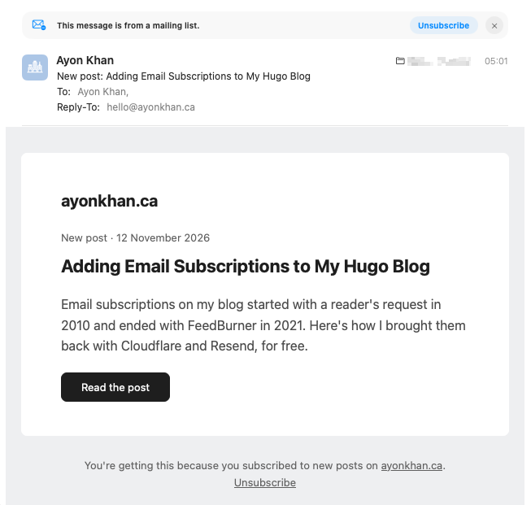

# Paperboy

[](https://github.com/ayonkhan/paperboy/actions/workflows/test.yml)
[](LICENSE)
[](https://github.com/ayonkhan/paperboy/releases)

**Paperboy** is a small Cloudflare Worker for sites with an RSS feed. When you publish a new post, it creates an email broadcast for it in [Resend](https://resend.com/), and Resend sends it to your subscribers. I use it on my blog, [ayonkhan.ca](https://www.ayonkhan.ca/).

<picture>
  <source media="(prefers-color-scheme: dark)" srcset="images/email-dark.png">
  
</picture>

Once an hour by default, it reads your feed. If the newest post is one it hasn't seen yet, it fills in the email template and creates a broadcast in Resend, scheduled two hours later by default. That gives you time to review the scheduled broadcast in Resend, and cancel it if something looks wrong. Paperboy doesn't check the email itself.

I built it for my Hugo blog, which uses the PaperMod theme, but it works with any site that has an RSS feed, whatever it's built with. It reads the live feed instead of watching your site's repo, so a post with a future date isn't emailed until it's actually published. The email template is simple, so you may want to change it to match your site. See [Customize](#customize).

Paperboy only creates the broadcasts. It doesn't collect subscribers, so you'll need some way of adding them to a segment in Resend: a subscription form, an import or adding them by hand. On my blog, that's [PaperMod Subscribe](https://github.com/ayonkhan/papermod-subscribe), a subscription form for Hugo sites using PaperMod.

## Contents

- [How It Works](#how-it-works)
- [Limitations](#limitations)
- [Requirements](#requirements)
- [Setup](#setup)
  - [1. Set Up Resend](#1-set-up-resend)
  - [2. Deploy Paperboy](#2-deploy-paperboy), in one of three ways:
    - [A. Fork on GitHub](#a-fork-on-github)
    - [B. Copy to your own repo](#b-copy-to-your-own-repo)
    - [C. Deploy from your computer](#c-deploy-from-your-computer)
  - [3. Fill In the Settings](#3-fill-in-the-settings)
- [Keep Your Feed Short](#keep-your-feed-short)
- [Customize](#customize)
- [Run Locally](#run-locally)
- [Check on It](#check-on-it)
- [Troubleshooting](#troubleshooting)
- [Tests](#tests)
- [License](#license)

## How It Works

- `src/index.js` reads the feed, compares the newest post with the last one it created a broadcast for, and creates the broadcast.
- `templates/new-post.mjml` is the email template, written in [MJML](https://mjml.io/). It's compiled to HTML on every build. Placeholders use `%%name%%`, so they don't clash with Resend's `{{{...}}}` placeholders.
- Cloudflare KV (`SENT_POSTS`) remembers the last post it created a broadcast for. On the very first run, it only records the newest post without creating a broadcast, so turning it on doesn't email an old post to everyone.

## Limitations

- **One post per check.** Each run creates a broadcast for the newest post only. If you publish two posts between checks, only the newer one gets a broadcast, and the older one is skipped. Checks run once an hour by default, set by `crons` in `wrangler.toml`. Leave at least that long between posts if you want an email for each.
- **Backdated posts are skipped.** A post only counts as new if it's the newest item in the feed, and feeds are usually sorted by each post's date. If you publish a post with a date older than your latest post, it isn't emailed. Set the date to the day you publish it.
- **Newest post first.** Paperboy uses the first item in the feed and doesn't sort by date. Hugo and most RSS feeds list the newest post first, but check yours.
- **One try per post.** A post is marked as done once Resend accepts the broadcast. If you cancel the scheduled broadcast in Resend, or it fails later, Paperboy won't try again. To send it anyway, create a broadcast for it in Resend yourself.
- **RSS 2.0 only.** Atom feeds aren't supported.

## Requirements

- A Cloudflare account, for the Worker and KV
- A [Resend](https://resend.com/) account with a verified domain
- An RSS 2.0 feed (Atom feeds aren't supported)
- [Node.js](https://nodejs.org/), only to deploy from your computer or [run it locally](#run-locally)

## Setup

Here's how the pieces fit together:

- **Resend** sends the emails. You'll need three things from it: a sending domain, a segment of subscribers and an API key.
- **Cloudflare** runs Paperboy on a schedule, once an hour by default, and keeps track of the last post it created a broadcast for in a KV namespace.
- **The settings** tell Paperboy where your feed is, who to email and how to reach Resend.

Setup takes three steps:

1. [Set up Resend](#1-set-up-resend)
2. [Deploy Paperboy](#2-deploy-paperboy), in one of three ways
3. [Fill in the settings](#3-fill-in-the-settings)

### 1. Set Up Resend

You'll use three things from Resend in step 3, so keep them handy:

1. **Your sending domain.** Add and verify it under **Domains**. Resend recommends a subdomain, such as `news.example.com`. Your sender address goes on this domain, and becomes `FROM_EMAIL`.
2. **A segment ID.** Under **Audience**, create a segment for subscribers, and copy its ID. This becomes `SEGMENT_ID`.
3. **An API key.** Under **API Keys**, create a key with **Full access**, and copy it. Paperboy creates broadcasts, and a key with only sending access can't do that. Resend only shows it once. This becomes `RESEND_API_KEY`.

### 2. Deploy Paperboy

Choose one way:

| Option | Best if | Deploys |
| --- | --- | --- |
| [A. Fork on GitHub](#a-fork-on-github) | You want the easiest setup, all in the browser | On every push to `main` |
| [B. Copy to your own repo](#b-copy-to-your-own-repo) | You want your own GitHub or GitLab repo, not a fork | On every push to `main` |
| [C. Deploy from your computer](#c-deploy-from-your-computer) | You don't need a repo | When you run a command |

Each option needs a KV namespace, where Paperboy remembers the last post it created a broadcast for. The steps link to [Create the KV Namespace](#create-the-kv-namespace) when it's time.

#### A. Fork on GitHub

1. Fork this repo on GitHub.
2. [Create the KV namespace](#create-the-kv-namespace), and put its ID in your fork's `wrangler.toml`. You can edit the file on GitHub, with the pencil icon.
3. [Connect the repo to Cloudflare](#connect-the-repo-to-cloudflare).

Then go to [step 3](#3-fill-in-the-settings).

#### B. Copy to Your Own Repo

1. Create an empty repo on GitHub or GitLab. Don't add a README or licence, so it stays empty.

2. Clone Paperboy, and go into its folder:

   ```bash
   git clone https://github.com/ayonkhan/paperboy.git
   ```

   ```bash
   cd paperboy
   ```

3. Point it to your repo instead of this one. Use your repo's URL:

   ```bash
   git remote set-url origin https://github.com/your-username/your-repo.git
   ```

4. [Create the KV namespace](#create-the-kv-namespace), put its ID in `wrangler.toml`, and commit the change:

   ```bash
   git commit -am "Use my KV namespace"
   ```

5. Push it to your repo:

   ```bash
   git push -u origin main
   ```

6. [Connect the repo to Cloudflare](#connect-the-repo-to-cloudflare).

Then go to [step 3](#3-fill-in-the-settings).

#### C. Deploy From Your Computer

You'll need [Node.js](https://nodejs.org/).

1. Clone Paperboy, and go into its folder:

   ```bash
   git clone https://github.com/ayonkhan/paperboy.git
   ```

   ```bash
   cd paperboy
   ```

2. Install the dependencies, at the exact versions in `package-lock.json`:

   ```bash
   npm ci
   ```

3. Log Wrangler in to your Cloudflare account:

   ```bash
   npx wrangler login
   ```

4. [Create the KV namespace](#create-the-kv-namespace), and put its ID in `wrangler.toml`.

5. Deploy. This compiles the email template and creates the Worker on Cloudflare:

   ```bash
   npm run deploy
   ```

   Run it again whenever you change something.

Then go to [step 3](#3-fill-in-the-settings).

#### Create the KV Namespace

In Cloudflare, go to **Storage & Databases > KV**, create a namespace called `SENT_POSTS`, and copy its ID.

Or, if you've logged Wrangler in, from the terminal:

```bash
npx wrangler kv namespace create SENT_POSTS
```

It prints the ID.

Then, in `wrangler.toml`, replace the `id` under `[[kv_namespaces]]` with yours:

```toml
[[kv_namespaces]]
binding = "SENT_POSTS"
id = "your-namespace-id"
```

Go back to the option you were following.

#### Connect the Repo to Cloudflare

1. In Cloudflare, go to **Workers & Pages**, click **Create**, and choose to import a repository.
2. Connect your GitHub or GitLab account, and choose your repo.
3. Keep the name `paperboy`, so it matches `name` in `wrangler.toml`.
4. Set the build command to `npm run build`, and the deploy command to `npx wrangler deploy`.
5. Deploy.

From then on, every push to `main` deploys Paperboy.

Go back to the option you were following.

### 3. Fill In the Settings

In Cloudflare, go to **Workers & Pages > paperboy > Settings > Variables and Secrets**, and add these as **Text** variables:

| Setting | Example | What it's for |
| --- | --- | --- |
| `SITE_NAME` | `example.com` | Shown at the top and bottom of the email |
| `SITE_URL` | `https://example.com/` | Where the site name links to |
| `FEED_URL` | `https://example.com/index.xml` | Your RSS feed |
| `FROM_EMAIL` | `Your Name <blog@news.example.com>` | The sender, on the domain you verified in step 1 |
| `REPLY_TO` | `hello@example.com` | Where replies go (optional) |
| `SEGMENT_ID` | the segment ID from step 1 | Who gets the email |
| `TIME_ZONE` | `America/Regina` | Used for the post date in the email (optional, defaults to `UTC`) |
| `DATE_LOCALE` | `en-US` | How the date is written (optional, defaults to `en-GB`, as in "7 November 2026") |
| `SEND_DELAY_HOURS` | `2` | How long to wait before sending, so you can check the email first (optional, defaults to `2`; use `0` to send right away) |

Then add the API key from step 1 as a **Secret** in the same place, named `RESEND_API_KEY`. If you deployed from your computer, you can set it from the terminal instead:

```bash
npx wrangler secret put RESEND_API_KEY
```

It asks you to paste the key, and stores it encrypted.

`keep_vars = true` in `wrangler.toml` makes deploys leave these settings alone. If you'd rather keep your settings in the repo, remove `keep_vars` and fill in the commented `[vars]` section in `wrangler.toml` instead.

That's it. Paperboy now checks your feed on its schedule, at the start of every hour by default. The first run only records your newest post, so the first email goes out with your next post. If an hourly run happens before you've added the settings, it stops with a `Missing settings` error, which is harmless.

## Keep Your Feed Short

Paperboy only needs the newest post, but it downloads and reads the whole feed on every run. On Cloudflare's free plan, each run gets 10 ms of CPU time, so a smaller feed leaves more room. Many sites list every post in their feed by default. If you don't post often, limiting it to the newest 20 or so is usually plenty. Feed readers use your feed too, so choose a limit that still covers the posts they might not have seen yet.

On Hugo, for example, add this to your site's config:

```yaml
services:
  rss:
    limit: 20
```

You can see how much CPU time each run uses under **Workers & Pages > paperboy > Metrics**.

## Customize

- **The email:** edit `templates/new-post.mjml`. The placeholders you can use are `%%title%%`, `%%description%%`, `%%link%%`, `%%date%%`, `%%site_name%%` and `%%site_url%%`. Keep `{{{RESEND_UNSUBSCRIBE_URL}}}`, since Resend needs it for the unsubscribe link.
- **The subject:** it's set in `src/index.js`, as `'New post: ' + post.title`.
- **How often it checks:** change `crons` in `wrangler.toml`.

## Run Locally

Running locally means running Paperboy on your own computer, without deploying it. It's for trying out changes, such as a new email template, before they reach Cloudflare and your subscribers. That's different from [option C](#c-deploy-from-your-computer), which deploys Paperboy to Cloudflare, where it runs every hour on its own.

You'll need a clone with the dependencies installed and Wrangler logged in, as in steps 1 to 3 of option C.

A local run can't see the settings you added in Cloudflare in [step 3](#3-fill-in-the-settings), so it needs its own copy, in a `.dev.vars` file in the project folder. Start from the example:

```bash
cp .dev.vars.example .dev.vars
```

Then fill it in. `.dev.vars` is in `.gitignore`, so it never gets committed. Local runs send real emails through Resend, using your real API key. Use a test segment with only your own address in it as `SEGMENT_ID`, so you don't email your subscribers by accident.

If a setting is missing, the run stops with an error naming it, such as `Missing settings: FEED_URL`.

Locally, KV starts empty, so the first run would only record the newest post. To make the newest post count as new, pretend an older post was the last one with a broadcast:

```bash
npx wrangler kv key put last-sent "https://example.com/posts/old/" --binding SENT_POSTS --local
```

Start the Worker. This also compiles the template, and lets you trigger the hourly job yourself:

```bash
npm run dev
```

Then, in a second terminal tab, trigger a run:

```bash
curl "http://localhost:8787/__scheduled?cron=0+*+*+*+*"
```

A new broadcast shows up in Resend under **Broadcasts**, scheduled to send after the delay set by `SEND_DELAY_HOURS`, two hours by default. Run the same command again, and nothing new should appear, since Paperboy now remembers that post. When you're done, unschedule or delete the test broadcast in Resend.

## Check on It

To see the last post Paperboy created a broadcast for:

```bash
npx wrangler kv key get last-sent --binding SENT_POSTS --remote
```

If a run fails, for example because Resend rejects the broadcast, the error shows up under **Workers & Pages > paperboy > Observability**.

## Troubleshooting

**A new post wasn't emailed.**
- On the very first run, Paperboy only records the newest post. The next new post is the first one to get a broadcast.
- The post has to be in your live RSS feed. Open `FEED_URL` in a browser and check that it's the first item.
- If you published two posts between checks, only the newer one gets a broadcast. See [Limitations](#limitations).
- Check the broadcast in Resend under **Broadcasts**. It's scheduled to send after `SEND_DELAY_HOURS`, two hours by default.

**A run failed.** The error shows up under **Workers & Pages > paperboy > Observability**.
- `Missing settings: ...` names the settings to add under **Settings > Variables and Secrets**.
- `Resend returned 4xx` usually means `FROM_EMAIL` isn't on a verified domain, `SEGMENT_ID` is wrong, or the API key doesn't have full access.
- `Exceeded CPU time limit` means the feed is too big for the free plan. See [Keep Your Feed Short](#keep-your-feed-short).

**Nothing happens at all.** Paperboy only reads RSS 2.0 feeds, with `<item>` entries. Atom feeds, with `<entry>`, aren't supported.

## Tests

The Worker has automated tests, which run on GitHub every time code is pushed. They use a fake feed and a fake Resend, so they don't need any accounts. To run them yourself:

```bash
npm test
```

This compiles the email template, then runs the tests.

## License

[MIT](LICENSE)
